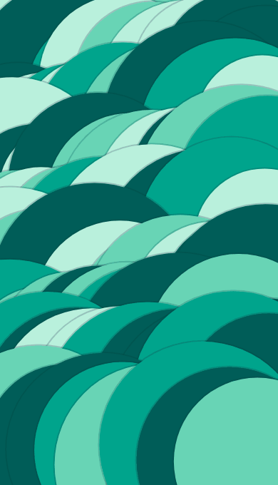
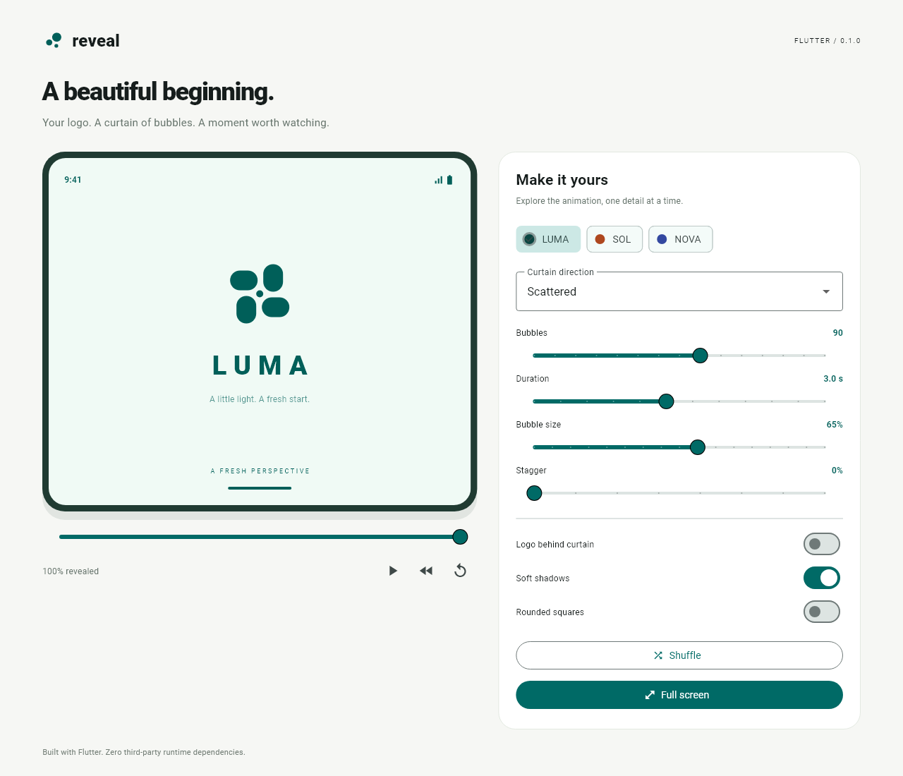

# Bubble Reveal Splash

A Flutter splash screen that opens a moving curtain of bubbles while your logo
grows from the center to its natural size. Customize the entire effect with
ordinary Flutter widgets. No third-party runtime dependencies.



- Any logo widget: an asset, text, icon, vector widget, or your own composition.
- Bubble colors, gradients, shapes, borders, shadows, density, and sizing.
- Seven travel directions, stagger, curves, scaling, and fading.
- Centered logo growth, custom placement, sliding, and optional fading.
- Automatic playback or an external controller for pause, reverse, replay, seek.
- Custom bubble geometry and builders, local layout, and reduced-motion support.

The example uses original **LUMA** vector branding, with mint, warm SOL, and blue
NOVA palettes. Replace it with your own branding in your application.

## Contents

- [Installation](#installation)
- [Quick start](#quick-start)
- [Logo widgets](#logo-widgets)
- [Colors and backgrounds](#colors-and-backgrounds)
- [Bubble count and size](#bubble-count-and-size)
- [Shapes, borders, gradients, and shadows](#shapes-borders-gradients-and-shadows)
- [Bubble motion](#bubble-motion)
- [Logo growth, fading, sliding, and placement](#logo-growth-fading-sliding-and-placement)
- [Timing and completion](#timing-and-completion)
- [Playback controls](#playback-controls)
- [Custom particles and builders](#custom-particles-and-builders)
- [Accessibility, layout, and performance](#accessibility-layout-and-performance)
- [API reference](#api-reference)
- [Example and development](#example-and-development)

## Installation

```sh
flutter pub add bubble_reveal_splash
```

Or add the dependency to your `pubspec.yaml`:

```yaml
dependencies:
  bubble_reveal_splash: ^0.1.0
```

```dart
import 'package:bubble_reveal_splash/bubble_reveal_splash.dart';
import 'package:flutter/material.dart';
```

Requires Dart 3.10+ and Flutter 3.38+. The widget uses Flutter rendering only;
no platform setup, permissions, network access, or bundled logo assets are needed.

## Quick start

This complete application reveals a logo, holds it for one second, then displays
the next screen. Use your own navigation inside `onCompleted` if preferred.

```dart
import 'package:bubble_reveal_splash/bubble_reveal_splash.dart';
import 'package:flutter/material.dart';

void main() => runApp(const MaterialApp(home: WelcomeSplash()));

class WelcomeSplash extends StatefulWidget {
  const WelcomeSplash({super.key});

  @override
  State<WelcomeSplash> createState() => _WelcomeSplashState();
}

class _WelcomeSplashState extends State<WelcomeSplash> {
  bool ready = false;

  @override
  Widget build(BuildContext context) => Scaffold(
    body: ready
        ? const Center(child: Text('Welcome!'))
        : BubbleSplash(
            logo: const FlutterLogo(size: 160),
            duration: const Duration(seconds: 3),
            holdDuration: const Duration(seconds: 1),
            logoAnimation: const BubbleLogoAnimation(
              startScale: 0,
              endScale: 1,
              startOpacity: 1,
            ),
            onCompleted: () => setState(() => ready = true),
          ),
  );
}
```

The quick start grows the logo from zero size at the center throughout the
reveal, keeping it opaque so the growth is visible. The default
`BubbleLogoAnimation()` also fades from opacity 0 to 1.

The remaining Dart snippets are widget expressions or clearly labeled complete
classes. They use the imports above unless extra imports are shown.

## Logo widgets

### Image asset

Register your own asset in your application's `pubspec.yaml`:

```yaml
flutter:
  assets:
    - assets/brand_logo.png
```

```dart
BubbleSplash(
  logo: Image.asset(
    'assets/brand_logo.png',
    width: 200,
    height: 200,
    fit: BoxFit.contain,
    semanticLabel: 'My brand',
  ),
)
```

### Text, icon, or composed logo

```dart
BubbleSplash(
  logo: const Column(
    mainAxisSize: MainAxisSize.min,
    children: [
      Icon(Icons.spa, size: 80, color: Color(0xFF005F59)),
      SizedBox(height: 16),
      Text('YOUR BRAND', style: TextStyle(fontSize: 28, letterSpacing: 4)),
    ],
  ),
)
```

The `logo` parameter accepts any `Widget`, including an SVG widget supplied by
a dependency in your application. Set the logo's natural size with that widget;
`endScale: 1` preserves this final size.

## Colors and backgrounds

### Solid background and custom palette

```dart
BubbleSplash(
  logo: const FlutterLogo(size: 160),
  backgroundColor: const Color(0xFF10182E),
  style: const BubbleStyle(
    colors: [Color(0xFF3548A8), Color(0xFF788CE8), Color(0xFFC4CFFF)],
  ),
)
```

### Background widget and foreground overlay

`background` fills the splash behind the bubbles and logo. `foreground` fills
the splash above them; use `Align` or `Positioned` inside a `Stack` to place its
contents. Use `IgnorePointer` for a decorative overlay that should not block taps.

```dart
BubbleSplash(
  logo: const FlutterLogo(size: 160),
  backgroundColor: Colors.white,
  background: const DecoratedBox(
    decoration: BoxDecoration(
      gradient: LinearGradient(
        colors: [Color(0xFFE1FFF5), Color(0xFFF6F8FF)],
        begin: Alignment.topLeft,
        end: Alignment.bottomRight,
      ),
    ),
  ),
  foreground: const IgnorePointer(
    child: SafeArea(
      child: Padding(
        padding: EdgeInsets.all(24),
        child: Align(
          alignment: Alignment.bottomCenter,
          child: Text('A fresh start'),
        ),
      ),
    ),
  ),
)
```

Layer order is background color, background widget, bubbles/logo, then foreground.
`logoOnTop: true` places the logo above the bubbles; false puts it under them.

## Bubble count and size

### Logical pixels

```dart
BubbleSplash(
  logo: const FlutterLogo(size: 160),
  style: const BubbleStyle(
    count: 60,
    minSize: 100,
    maxSize: 240,
  ),
)
```

### Responsive sizes

```dart
SizedBox(
  width: 340,
  height: 560,
  child: BubbleSplash(
    logo: const FlutterLogo(size: 140),
    seed: 42,
    style: const BubbleStyle(
      count: 75,
      relativeSize: true,
      minSize: 0.35,
      maxSize: 0.75,
    ),
  ),
)
```

Here sizes are fractions of the shortest **local** side: 119–255 logical pixels
in a 340 × 560 box. `count: 0` removes the bubbles and keeps the logo animation.
Use a nonempty palette unless a custom `particleFactory` supplies colors.

A fixed `seed` reproduces the same field on replay. Changing the seed regenerates
it. The starting field uses a jittered grid; low counts or small bubbles can leave
gaps. Replace settings objects and lists instead of mutating them in place.

## Shapes, borders, gradients, and shadows

### Rounded squares with a border

```dart
BubbleSplash(
  logo: const FlutterLogo(size: 160),
  style: BubbleStyle(
    shape: BoxShape.rectangle,
    borderRadius: BorderRadius.circular(28),
    border: Border.all(color: Colors.white, width: 2),
    shadows: const [],
  ),
)
```

`BoxShape.circle` is the default. Corner radii apply only to rectangles.

### Gradient bubbles and custom shadows

```dart
BubbleSplash(
  logo: const FlutterLogo(size: 160),
  style: const BubbleStyle(
    gradient: RadialGradient(
      colors: [Color(0xFFB9F3DF), Color(0xFF007F7A)],
      center: Alignment.topLeft,
      radius: 1.2,
    ),
    shadows: [
      BoxShadow(
        color: Color(0x33003836),
        offset: Offset(0, 6),
        blurRadius: 16,
        spreadRadius: 2,
      ),
    ],
  ),
)
```

A gradient takes visual precedence over each particle's solid color. Use
`shadows: []` to remove shadows, or supply multiple `BoxShadow` objects.

## Bubble motion

### Opening direction

```dart
BubbleSplash(
  logo: const FlutterLogo(size: 160),
  motion: const BubbleMotion(direction: BubbleDirection.horizontal),
)
```

| `BubbleDirection` | Movement |
| --- | --- |
| `scattered` | Random endpoints, matching the original curtain idea |
| `left` / `right` | All bubbles travel toward that horizontal edge |
| `up` / `down` | All bubbles travel toward that vertical edge |
| `horizontal` | Left half travels left; right half travels right |
| `vertical` | Top half travels up; bottom half travels down |

### Travel, stagger, scaling, fading, and curves

```dart
BubbleSplash(
  logo: const FlutterLogo(size: 160),
  motion: const BubbleMotion(
    direction: BubbleDirection.horizontal,
    travelDistance: 1.4,
    maxDelay: 0.2,
    curve: Curves.easeInOutCubic,
    startScale: 1.1,
    endScale: 0,
    scaleCurve: Curves.easeInCubic,
    fadeStart: 0.4,
    endOpacity: 0,
    fadeCurve: Curves.easeOut,
  ),
)
```

`travelDistance` is measured in local width/height multiples for directional
travel; scattered endpoints are random. `maxDelay` is the maximum fraction of
the whole timeline a bubble waits before starting. All bubbles still finish at
progress 1. Each bubble's `fadeStart` is relative to its own delayed timeline.

`curve`, `scaleCurve`, and `fadeCurve` independently control position, scale,
and opacity. `endScale: 0` removes bubbles at the end even if `endOpacity` is
nonzero. Set `endScale` above zero to retain bubbles in the final state.

## Logo growth, fading, sliding, and placement

### Grow from a point in the center

```dart
BubbleSplash(
  logo: const FlutterLogo(size: 180),
  logoAnimation: const BubbleLogoAnimation(
    begin: 0,
    end: 1,
    curve: Curves.linear,
    startScale: 0,
    endScale: 1,
    startOpacity: 1,
    endOpacity: 1,
    startOffset: Offset.zero,
    endOffset: Offset.zero,
  ),
)
```

The logo stays centered and grows alongside the curtain for the full reveal.
Set `startScale: 0.05` if you prefer a tiny visible logo at the initial frame.

### Delayed fade and slide with custom placement

```dart
BubbleSplash(
  logo: const FlutterLogo(size: 160),
  logoAlignment: Alignment.topCenter,
  logoPadding: const EdgeInsets.only(top: 100, left: 24, right: 24),
  logoOnTop: false,
  logoAnimation: const BubbleLogoAnimation(
    begin: 0.2,
    end: 0.9,
    curve: Curves.easeOutCubic,
    startScale: 0.25,
    endScale: 1,
    startOpacity: 0,
    endOpacity: 1,
    startOffset: Offset(0, 32),
    endOffset: Offset.zero,
  ),
)
```

`begin` and `end` are fractions of the overall timeline; offsets are logical
pixels. `logoPadding` and `logoAlignment` also support directional values.
The default transforms scale about the logo's center. `logoBuilder` replaces
these transforms entirely when you need a different pivot or animation.

## Timing and completion

```dart
BubbleSplash(
  logo: const FlutterLogo(size: 160),
  startDelay: const Duration(milliseconds: 300),
  duration: const Duration(milliseconds: 2400),
  holdDuration: const Duration(milliseconds: 800),
  onProgress: (progress) {
    // 0–1 progress from animation updates.
  },
  onStatusChanged: (status) {
    // AnimationStatus.forward, reverse, completed, or dismissed.
  },
  onCompleted: () {
    // Reveal + hold completed. Navigate or replace the splash here.
  },
)
```

With internal automatic playback, completion occurs after start delay + reveal
duration + hold. The splash does not navigate itself. Coordinate any async
application initialization in your app before navigating.

`onCompleted` fires once per reveal after reaching progress 1 and waiting for
the hold. Rewinding below 1 or reversing cancels a pending completion and rearms
it. Pausing at progress 1 does not pause the independent hold timer. Changing
`holdDuration` while a hold is pending restarts that hold. Disposal cancels
pending start and completion timers.

`onProgress` reports controller updates; it is not an initial-frame callback.
`onStatusChanged` reports subsequent status changes. See reduced-motion behavior
below for the case where the external controller stays untouched.

## Playback controls

This complete widget owns its controller and exposes play, pause, reverse,
replay, and seek. With an external controller the caller owns its duration,
initial value, playback, and disposal. `autoStart`, `duration`, and `startDelay`
configure only an internally created controller.

```dart
class ControlledSplash extends StatefulWidget {
  const ControlledSplash({super.key});

  @override
  State<ControlledSplash> createState() => _ControlledSplashState();
}

class _ControlledSplashState extends State<ControlledSplash>
    with SingleTickerProviderStateMixin {
  late final controller = AnimationController(
    vsync: this,
    duration: const Duration(seconds: 3),
  );

  @override
  Widget build(BuildContext context) => Column(
    children: [
      Expanded(
        child: BubbleSplash(
          controller: controller,
          seed: 42,
          logo: const FlutterLogo(size: 160),
          logoAnimation: const BubbleLogoAnimation(startOpacity: 1),
        ),
      ),
      Wrap(
        spacing: 8,
        children: [
          TextButton(
            onPressed: () => controller.forward(),
            child: const Text('Play'),
          ),
          TextButton(
            onPressed: () => controller.stop(),
            child: const Text('Pause'),
          ),
          TextButton(
            onPressed: () => controller.reverse(),
            child: const Text('Reverse'),
          ),
          TextButton(
            onPressed: () => controller.forward(from: 0),
            child: const Text('Replay'),
          ),
        ],
      ),
      AnimatedBuilder(
        animation: controller,
        builder: (context, child) => Slider(
          value: controller.value,
          onChanged: (value) {
            controller.stop();
            controller.value = value;
          },
        ),
      ),
    ],
  );

  @override
  void dispose() {
    controller.dispose();
    super.dispose();
  }
}
```

Place `ControlledSplash` inside bounded space such as a Scaffold body.
Without an external controller, `autoStart: false` leaves the initial frame
visible. Use an external controller to start later. Changing the widget key
restarts internal playback. An external controller initially set to 1 schedules
completion after the hold.

## Custom particles and builders

### Exact geometry and seeded randomness

```dart
BubbleSplash(
  seed: 42,
  logo: const Text('MY BRAND'),
  style: const BubbleStyle(count: 40),
  particleFactory: (index, count, random) => BubbleParticle(
    diameter: 100 + random.nextDouble() * 80,
    color: index.isEven ? Colors.teal : Colors.cyan,
    start: Offset(random.nextDouble(), random.nextDouble()),
    end: Offset(index.isEven ? -0.5 : 1.5, random.nextDouble()),
    delay: random.nextDouble() * 0.2,
  ),
)
```

Positions are normalized bubble **centers**: (0, 0) is the local top left and
(1, 1) the bottom right. Values outside this range are allowed. A particle's
diameter uses the same pixel/relative-size convention as `BubbleStyle`.

The factory runs when the field is generated, not per animation tick. Use its
supplied Random for repeatable seeded geometry. It replaces default size/color/
path/delay generation, including `direction`, `travelDistance`, and `maxDelay`.
Style count, relative sizing, and motion curves/scale/fade still apply.

### Custom bubble appearance

```dart
BubbleSplash(
  logo: const FlutterLogo(size: 160),
  bubbleBuilder: (context, particle, frame) => DecoratedBox(
    decoration: BoxDecoration(
      shape: BoxShape.circle,
      color: particle.color.withValues(alpha: 0.15),
      border: Border.all(color: particle.color, width: 3),
    ),
  ),
)
```

The builder replaces the bubble decoration, including default shadows, gradient,
and border. The package still applies the box size, position, scale, and opacity.
`BubbleFrame` supplies per-particle progress, scale, opacity, center, and diameter.
Use it for progress-dependent content; keep per-frame builders lightweight.

### Custom logo animation

```dart
BubbleSplash(
  logo: const FlutterLogo(size: 160),
  logoBuilder: (context, progress, logo) => Transform.rotate(
    angle: (1 - progress) * 0.4,
    child: Transform.scale(scale: progress, child: logo),
  ),
)
```

This replaces `BubbleLogoAnimation`; opacity, scale, translation, and curves are
then your responsibility. Logo alignment, padding, and layer order still apply.
The supplied progress is the overall timeline rather than per-particle progress.

## Accessibility, layout, and performance

```dart
SizedBox(
  width: 340,
  height: 560,
  child: BubbleSplash(
    logo: Semantics(
      label: 'My brand logo',
      child: const FlutterLogo(size: 160),
    ),
    semanticsLabel: 'Welcome to My Brand',
    respectReducedMotion: true,
    clipBehavior: Clip.hardEdge,
    style: const BubbleStyle(count: 45, shadows: []),
  ),
)
```

The splash requires bounded width **and** height. Use Scaffold body, Expanded,
AspectRatio inside bounded width, or SizedBox. It uses local constraints rather
than full-screen dimensions. Put it inside SafeArea if your logo should respect
system insets. `clipBehavior` controls overflow; `Clip.none` allows it outside
the splash's bounds.

By default, `MediaQuery.disableAnimations` displays progress 1 immediately and
schedules completion after the hold, skipping the reveal and start delay.
An external controller is not started, stopped, advanced, or disposed, so its
status/value callbacks do not synthesize a playback cycle. To handle the platform
preference yourself, use `respectReducedMotion: false`.

Reduce count or remove shadows on constrained devices. A fixed seed does not
regenerate random geometry per tick. Profile your count, builders, and effects
on intended devices; no specific frame rate is guaranteed.

## API reference

The snippets above cover every configurable visual and playback property.
Defaults below are useful when adapting a theme.

### `BubbleSplash`

| Parameter | Default / role |
| --- | --- |
| `logo` | Required; any Widget |
| `style`, `motion`, `logoAnimation` | Configuration objects described below |
| `duration` | 3 seconds; internal controller only |
| `startDelay` | Zero; internal automatic playback only |
| `holdDuration` | 1 second before completion callback |
| `autoStart` | true; internal playback only |
| `controller` | null; provide an AnimationController for manual playback |
| `seed` | null; supply an integer for reproducible fields |
| `backgroundColor` | `Color(0xFFF3FBF7)` |
| `background`, `foreground` | null; full-size widget layers |
| `logoAlignment`, `logoPadding` | center, zero padding |
| `logoOnTop` | true; false places the logo under bubbles |
| `particleFactory`, `bubbleBuilder`, `logoBuilder` | null; custom geometry/rendering |
| `onCompleted`, `onProgress`, `onStatusChanged` | null; optional callbacks |
| `respectReducedMotion` | true |
| `clipBehavior` | `Clip.hardEdge` |
| `semanticsLabel` | null; optional splash announcement |

### `BubbleStyle`

| Parameter | Default / role |
| --- | --- |
| `count` | 90; zero or more bubbles |
| `colors` | Four teal/mint colors |
| `minSize`, `maxSize` | 180, 300 logical pixels |
| `relativeSize` | false; true uses fractions of shortest local side |
| `shadows` | One subtle shadow; `[]` disables it |
| `shape` | `BoxShape.circle` |
| `borderRadius` | Radius 32; used for rectangles only |
| `border` | null |
| `gradient` | null; overrides solid color visually |

### `BubbleMotion`

| Parameter | Default / role |
| --- | --- |
| `direction` | `BubbleDirection.scattered` |
| `curve`, `scaleCurve`, `fadeCurve` | `Curves.linear` |
| `fadeStart`, `endOpacity` | 0.6, 0.2 |
| `startScale`, `endScale` | 1, 0 |
| `maxDelay` | 0; range 0 inclusive to 1 exclusive |
| `travelDistance` | 1.2; directional travel distance |

### `BubbleLogoAnimation`

| Parameter | Default / role |
| --- | --- |
| `begin`, `end` | 0, 1; require 0 ≤ begin < end ≤ 1 |
| `curve` | `Curves.linear` |
| `startScale`, `endScale` | 0, 1 |
| `startOpacity`, `endOpacity` | 0, 1; set start to 1 for growth without fading |
| `startOffset`, `endOffset` | `Offset.zero`; logical pixel translation |

## Example and development

[Browse the interactive example](https://github.com/ZakariaEysa/bubble_reveal_splash/tree/main/example)
or run it from a checkout:

```sh
cd example
flutter pub get
flutter run -d chrome
```

The example contains Android, iOS, web, and Windows runners. Build iOS on macOS.
The package itself uses platform-independent Flutter widgets. Android/iOS/native
desktop builds have not been verified as part of the initial web validation.



To use a local checkout before publication:

```yaml
dependencies:
  bubble_reveal_splash:
    path: ../bubbles
```

From the package root:

```sh
flutter pub get
flutter analyze
flutter test
cd example
flutter test
flutter build web
```

See the [Arabic setup guide](https://github.com/ZakariaEysa/bubble_reveal_splash/blob/main/START_HERE_AR.md),
[changelog](https://github.com/ZakariaEysa/bubble_reveal_splash/blob/main/CHANGELOG.md),
and [issue tracker](https://github.com/ZakariaEysa/bubble_reveal_splash/issues).
Licensed under the MIT License. First-release publishing steps are in
`PUBLISHING.md` in the source repository.
